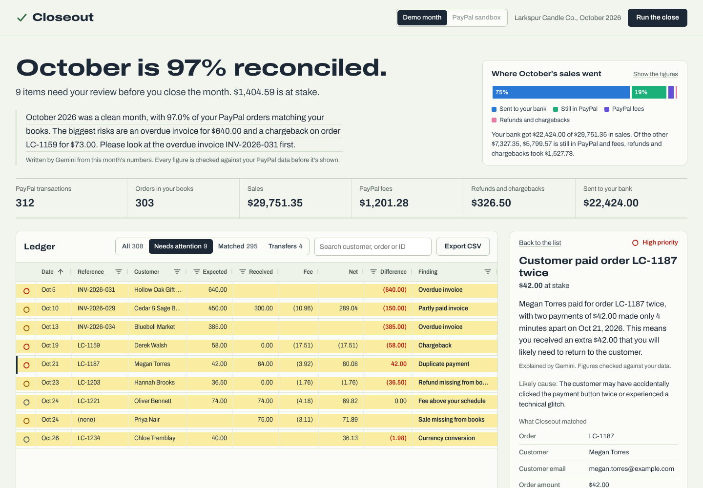

# Closeout

**Month-end reconciliation for small businesses that sell through PayPal.**

Closeout pulls a month of PayPal transactions and invoices, matches every one against your own order records, and explains whatever doesn't tie out in plain English. Then it helps you fix it: refund a duplicate payment, send an invoice reminder, or record an adjusting entry for your bookkeeper. Nothing happens until you approve it.

Built for the [PayPal AI Hackathon 2026](https://paypalaihackathon.devpost.com/).



## The problem

A small seller with a few hundred PayPal sales a month closes the books in a spreadsheet: export transactions, export orders, VLOOKUP, squint. The things that slip through are the expensive ones. A customer charged twice, a wholesale invoice nobody chased, a refund issued in PayPal that never reached the books, a chargeback that quietly took back a sale plus a fee. Accounting tools match bank deposits, but PayPal payouts are lumped together, net of fees, and spread across currencies, so the real detail lives in PayPal.

Closeout does the matching the way a bookkeeper would: tick off everything that ties out, highlight what doesn't, and explain each exception in language the owner can act on.

## Try it in two minutes (no keys needed)

Requires Python 3.11 or newer.

```bash
git clone https://github.com/sunnydigital1/closeout
cd closeout
python -m venv .venv
# Windows:      .venv\Scripts\activate
# macOS/Linux:  source .venv/bin/activate
pip install -r requirements.txt
uvicorn app.main:app --reload
```

Open http://localhost:8000. The **demo month** is a fictional candle shop's October 2026: 312 PayPal transactions in the exact format PayPal's APIs return, 303 order records, and nine planted problems. It runs with no keys at all. Explanations come from Closeout's rules until you add an AI key.

## Turn on the AI (free)

1. Copy `.env.example` to `.env`.
2. Get a free key at [aistudio.google.com/apikey](https://aistudio.google.com/apikey) and set `GEMINI_API_KEY`.
3. Restart. Explanations, the month-end summary and "Ask about this month" are now written by Gemini.

To use Claude instead, set `AI_PROVIDER=claude` and `ANTHROPIC_API_KEY`.

## Connect your PayPal sandbox

1. In the [PayPal Developer Dashboard](https://developer.paypal.com/dashboard/applications/sandbox), open your sandbox app and copy the **Client ID** and **Secret** into `.env`.
2. On the same app page, under **Features**, turn on **Transaction search** and **Invoicing**. PayPal can take a few hours to enable new permissions.
3. Restart Closeout and open the **sandbox test store** at http://localhost:8000/store. It plays the part of your shop's order system:
   - **Create the wholesale invoices**: four invoices through the Invoicing API (created, sent, and one paid and one partly paid by recorded bank transfer).
   - **Make five or six sales** through real PayPal Checkout. Log in with your sandbox buyer from *Testing Tools → Sandbox Accounts*. Each sale is written to your books, `data/sandbox/orders.csv`.
   - **Create the mistakes**: charge a customer twice, take a payment that never reaches your books, and refund an order in PayPal only.
4. Switch Closeout to **PayPal sandbox** and click **Run the close**. You don't have to wait: PayPal's transaction search can take up to three hours to report new payments, so Closeout reads how current PayPal's data is and shows sales it hasn't reported yet as *waiting for PayPal* instead of flagging them. Run the close again later to check them. Invoices show up right away. Approved actions call the real PayPal sandbox API with test money.

**Using your own books instead:** put a CSV at `data/sandbox/orders.csv` with columns `order_id, date, customer_name, customer_email, channel (web|invoice), reference, amount, currency, status (paid|invoiced|refunded)`. For checkout orders, `reference` is the order number your store sends to PayPal (as `invoice_id` or `custom_id`); for invoiced orders it's the PayPal invoice number.

## How it works

```
PayPal Transaction Search ─┐
PayPal Invoicing ──────────┼─▶ matching engine ─▶ ledger + exceptions ─▶ AI explains ─▶ you approve ─▶ PayPal API
Your order records (CSV) ──┘     (plain code)        (exact figures)      (words only)                  (refund, reminder)
```

**The engine owns the numbers, the AI owns the words.** Every match, difference and dollar amount is computed in plain, tested code (`app/reconcile.py`). The model is only asked to explain those results.

**Numbers guardrail.** Before any AI text is shown, Closeout extracts every number in it and checks that each one appears in the facts the model was given. Text with an invented figure is retried once, then replaced with a rule-based explanation. A wrong number never reaches the owner (`app/ai.py`, covered by tests).

**What it catches**

| Exception | Example in the demo month | Suggested fix |
|---|---|---|
| Duplicate payment | Order LC-1187 paid twice, 4 minutes apart | Refund the duplicate |
| Overdue invoice | INV-2026-031, $640.00, 13 days late | Send PayPal's reminder with a drafted note |
| Partly paid invoice | INV-2026-029, $150.00 still due | Send a reminder for the balance |
| Refund missing from books | $36.50 refunded in PayPal, still "paid" in the books | Record an adjusting entry |
| Chargeback | $58.00 taken back plus a $15.00 dispute fee | Review the dispute, record the reversal |
| Fee above your schedule | A UK sale charged the cross-border rate | Mark reviewed or record the extra fee |
| Currency conversion | A CAD payment that landed $1.98 short | Record the FX loss |
| Sale missing from books | A $75.00 payment with no order | Add the sale to the books |
| Payment or invoice missing in PayPal | Marked paid in the books, nothing in PayPal | Investigate |

**Approval before action.** Every action shows exactly what will happen first, including the PayPal API call and an editable note to the customer. Refunds use a deterministic `PayPal-Request-Id`, and Closeout refuses to move money twice for the same item. In the demo month every action is simulated.

## PayPal APIs used

| API | Endpoint | Used for |
|---|---|---|
| OAuth 2.0 | `POST /v1/oauth2/token` | Client-credentials access token |
| Transaction Search | `GET /v1/reporting/transactions` | Every payment, refund, chargeback, conversion and transfer in the month |
| Invoicing v2 | `GET /v2/invoicing/invoices`, `GET /v2/invoicing/invoices/{id}` | Invoice status, amounts paid and due |
| Invoicing v2 | `POST /v2/invoicing/invoices/{id}/remind` | Payment reminders, with the AI-drafted note |
| Payments v2 | `POST /v2/payments/captures/{id}/refund` | Refunding a duplicate payment |

The sandbox test store also uses the **PayPal JS SDK** buttons with **Orders v2** (`POST /v2/checkout/orders`, `/capture`) for real checkouts, and **Invoicing v2** (`POST /v2/invoicing/invoices`, `/send`, `/payments`) to create the wholesale invoices.

## Project layout

```
app/
  reconcile.py   matching engine and exception rules
  ai.py          Gemini / Claude providers, prompts, numbers guardrail, fallbacks
  paypal.py      PayPal REST client
  normalize.py   PayPal API responses and books CSV -> models
  actions.py     approval-gated actions
  store.py       sandbox test store: real checkouts plus the messy cases
  main.py        FastAPI app and JSON API
static/          dashboard and test store (vanilla JS + AG Grid Community)
scripts/         demo-month generator
data/sample/     the demo month, in PayPal API format
tests/           53 tests, no network needed
```

## Tests

```bash
pytest
```

## Deploy

`render.yaml` deploys the app on Render's free tier. Add `GEMINI_API_KEY` (and optionally the PayPal sandbox keys) in the Render dashboard.

## Notes

- The demo month is a fictional business. Every name, email and ID in it is made up.
- The dashboard bundles AG Grid Community and AG Charts Community (MIT) and the Archivo typeface (SIL Open Font License).
- Built with AI pair-programming assistance (Claude).

## License

[MIT](LICENSE)
